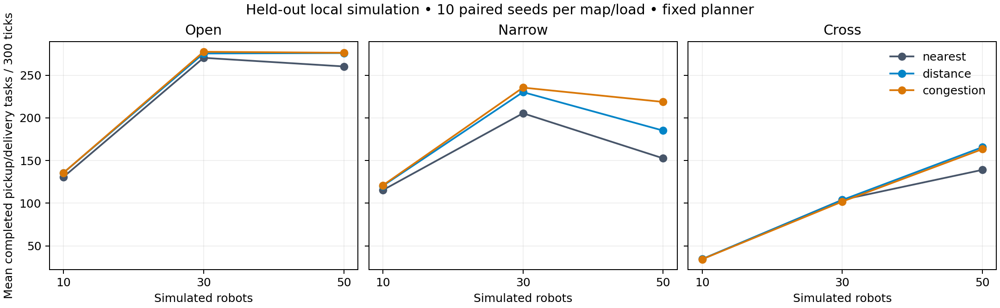
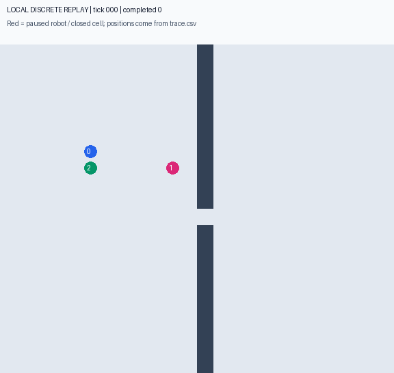

# Warehouse Fleet Autonomy Lab

A C++20 planning simulator with a ROS 2 / Gazebo execution adapter. The discrete benchmark asks: **does congestion-aware task allocation improve warehouse throughput when the planner and task stream stay fixed?** It models pickup→delivery tasks, concurrent grid motion and bounded reservation planning, with independent collision checks and reproducible experiments.





[Download the MP4 demo](docs/assets/recovery.mp4). The animation is generated from an actual discrete trace. The separate [ROS 2 / Gazebo SIL layer](docs/sil-design.md) runs one or three physical simulated robots through Nav2, with delayed-lidar, actuator-hold, controller-restart and lifecycle-response-loss tests. Built with coding-agent assistance; no physical hardware was used.

## Build and reproduce

CMake 3.20+, a C++20 compiler and Python 3.10+; no downloaded C++ or Python dependencies for the core, tests or benchmark.

```bash
cmake -S . -B build -DCMAKE_BUILD_TYPE=Release
cmake --build build -j4
ctest --test-dir build --output-on-failure
mkdir -p runs
./build/fleet simulate --map maps/narrow.map --agents 10 --seed 100 \
  --strategy congestion --lambda 2 --max-expansions 2000 --out runs/demo
./build/fleet replay --map maps/narrow.map --trace runs/demo/trace.csv
python3 benchmarks/run.py --out runs/evaluation
```

Choose a **new** output directory each time. Completed runs contain summary.json, events.jsonl, trace.csv and COMPLETE; an interrupted/failed run is not benchmark evidence. The batch runner compresses raw logs after independent verification. `--help` lists budgets, queue limits and fault inputs. The standard protocol is 360 runs: 3 maps × 3 fleet sizes × 10 seeds × (3 methods + lambda=0 ablation).

```bash
./build/fleet simulate --map maps/narrow.map --agents 3 --ticks 160 --seed 100 \
  --strategy congestion --lambda 2 --max-expansions 2000 \
  --faults configs/faults.txt --out runs/fault-demo
python3 scripts/check_evidence.py
```

Optional plot generation uses `requirements-tools.txt` and `scripts/render_results.py`. Example:

```bash
python3 -m venv .venv
.venv/bin/pip install -r requirements-tools.txt
.venv/bin/python scripts/render_results.py --results docs/evidence/held-out \
  --demo docs/evidence/recovery --map maps/narrow.map
```

## Run ROS 2 / Gazebo qualification

Docker Engine on Linux and Python 3.10+ are required. The command builds the Jazzy/Harmonic dependency image and C++ adapter, exercises actual ROS service contracts, then runs six isolated episodes and a deliberate collision positive control. It retains MCAP bags, generated worlds/configurations, action events and independent verification reports. Use a fresh output path inside this checkout.

```bash
python3 scripts/sil/qualify.py --out runs/sil/my-qualification
```

A [bounded lifecycle recovery patch](docs/lifecycle-recovery.md) handles missing responses with state confirmation and no blind mutation retries. The physics suite runs locally; hosted CI builds the adapter and tests DDS service contracts. [Measured SIL results and artifact replay](docs/sil-validation.md) explain the evidence boundary and reproduction commands.

## What is implemented

- Deterministic greedy total-service-distance allocation, rectangular Hungarian assignment, and a congestion penalty with a zero-lambda control.
- Time-expanded A*, endpoint holding, opposite-edge/vertex exclusion and validate-before-commit reservation updates.
- Queue/candidate/search budgets, typed planning outcomes, explicit fault epochs, task requeue/cargo retention and no-progress events.
- JSON metrics/events, trace replay, an independent C++ execution checker and Python artifact oracle; source/binary fingerprints and bounded subprocess experiments.
- CTest regressions, address/undefined/leak sanitizer verification, GitHub Actions and trace-derived recovery visualization.
- Typed C++ allocation service, three isolated Nav2/AMCL/TF stacks, feedback-confirmed transit ownership and independent stale-input velocity gates.
- Actual Gazebo physics/sensor fault cases, controller respawn, MCAP recording and a separate ground-truth/command/contact oracle with a deliberate wall-impact positive control.

[Evaluation and measured results](docs/evaluation.md) · [Architecture and state transitions](docs/design.md) · [Failure analysis](docs/failure-analysis.md) · [Market rationale](docs/market-and-technology.md) · [Upstream compatibility](docs/upstream.md) · [Verification](docs/verification.md) · [中文说明](README.zh-CN.md)

## Limits

The planner is prioritized and finite-horizon, so collision-free execution does not imply progress or completeness. Congestion scores are approximate; negative results are retained. The SIL adapter conservatively serializes whole missions under one transit lease while all three Nav2 stacks run. It does not implement durable coordinator recovery, general continuous-space multi-agent planning, real hardware/HIL, a production service or an ML model. Discrete 10–50 robot benchmark numbers and 1–3 robot Gazebo qualification are separate evidence scopes; neither implies production safety or throughput.
