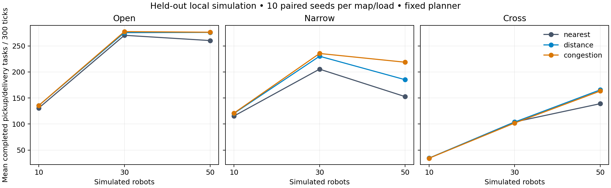

# Evaluation — frozen local discrete benchmark

## Protocol and environment

Final matrix: **360 verified runs** = three maps × 10/30/50 robots × ten held-out seeds (100–109) × nearest, distance, congestion and congestion-zero. The three primary methods have **90 runs each**; lambda=0 adds another 90. Each run offers one pickup/delivery task every tick for 300 ticks, with capacity 400. All 300 offers were admitted per run. Every map has sufficient unique traversable starting cells.

All methods share H=64, 2,000 A* expansions per call, deterministic robot priority and no wall-clock deadline. W=16 and lambda=2 were prespecified; development uses a different map and seeds 1–3. No parameter was selected on held-out outcomes. The first matrix was exploratory and excluded because code hardening overlapped it. This final matrix ran after final tests on fixed source and binary. The order of methods rotates by seed to reduce a fixed-order timing bias.

Environment: Ubuntu 26.04.1, Intel Core i9-13900K, 32 logical CPUs, 129,209,084 KiB RAM; GCC 15.2.0; CMake 4.2.3; Release `-O3 -DNDEBUG`; Python 3.14.4. One experiment process at a time on a shared local host. No CPU affinity, dedicated-host isolation or real-time scheduling. Static map construction and BFS cache setup occur before allocation/planning timers. No cross-run cache or warmup is used. Start recorded at 2026-09-07T01:57:17.520845+00:00.

[Frozen configuration](../configs/evaluation.json) · [environment and source/binary SHA-256](evidence/held-out/environment.json) · [all runs](evidence/held-out/runs.jsonl) · [group summaries](evidence/held-out/summary.json) · [raw compressed artifacts](evidence/held-out/raw-runs.tar.gz)

## Throughput and unfinished work

Values below are means over ten identical-input seeds. A completion requires pickup and delivery at their reserved service endpoints. Throughput is completions / 300 **simulation ticks**, not wall seconds. Unfinished = 300 − completed in this matrix; no cutoff failures are silently removed.

| Map | Robots | Nearest completed | Distance completed | Congestion completed | Congestion unfinished | Congestion minus nearest (min..max paired tasks) |
|---|---:|---:|---:|---:|---:|---:|
| open | 10 | 130.7 | 135.6 | 135.6 | 164.4 | 1..10 |
| open | 30 | 270.4 | 275.5 | 277.5 | 22.5 | 3..11 |
| open | 50 | 260.3 | 276.0 | 276.3 | 23.7 | 10..23 |
| narrow | 10 | 115.3 | 120.3 | 120.9 | 179.1 | 2..12 |
| narrow | 30 | 205.4 | 230.2 | 235.5 | 64.5 | -7..178 |
| narrow | 50 | 152.6 | 185.1 | 218.7 | 81.3 | -8..194 |
| cross | 10 | 34.4 | 34.5 | 34.3 | 265.7 | -1..0 |
| cross | 30 | 104.0 | 103.8 | 101.9 | 198.1 | -19..3 |
| cross | 50 | 139.1 | 165.7 | 163.4 | 136.6 | 3..97 |



At narrow/50, congestion completes 218.7 tasks versus nearest 152.6 (**+43.3%** in this condition) and distance 185.1 (**+18.2%**). This is a measured allocator comparison under a fixed planner, not a code-speedup or real warehouse productivity claim. At cross/30, congestion completes 101.9 versus nearest 104.0 (**−2.0%**) and distance 103.8. At cross/50, distance slightly outperforms congestion. Thus the congestion term is not uniformly beneficial and is not promoted as the default universal policy.

All **3,240,000 robot steps** pass both execution/trace checks with zero observed vertex or opposite-edge conflicts. All 90 distance-vs-zero-lambda pairs have identical trajectory digests. This verifies this workload, not probabilistic safety, planner completeness or hardware correctness. No-progress events and unfinished tasks remain in every raw record; congestion narrow/50 has 2 no-progress events, and congestion cross/30 has 9.

## Decision latency

P95 uses nearest-rank over all measured `plan()` calls in each map/load/method group, **not an average of p95 values**. It includes A* allocation/search but excludes reservation-table preparation/commit. Allocation latency samples, successful completion-time samples and per-run p50/p95 are available in each archived summary. Total process wall time includes file I/O and independent verification. Empty completion distributions are null; unfinished counts remain alongside successful latency samples.

| Map | Robots | Nearest planning p95 (µs) | Distance planning p95 (µs) | Congestion planning p95 (µs) |
|---|---:|---:|---:|---:|
| open | 10 | 261.4 | 210.9 | 213.1 |
| open | 30 | 341.9 | 362.0 | 313.7 |
| open | 50 | 362.2 | 359.0 | 363.0 |
| narrow | 10 | 309.4 | 316.1 | 232.6 |
| narrow | 30 | 315.8 | 316.4 | 315.2 |
| narrow | 50 | 316.9 | 319.9 | 336.3 |
| cross | 10 | 329.8 | 298.4 | 281.4 |
| cross | 30 | 330.6 | 329.6 | 326.2 |
| cross | 50 | 323.6 | 308.2 | 309.5 |

These are descriptive ten-seed results without confidence intervals or a statistical-significance claim. Shared-host scheduling affects microsecond timing; no universal latency reduction is claimed. Planner budget counts and raw timing distributions let a reviewer separate incomplete search from slow decisions.

## Reproduce and inspect

```bash
python3 benchmarks/run.py --out runs/new-evaluation
python3 scripts/check_evidence.py
# Optional extraction for a particular trace (archive contains relative run IDs):
mkdir -p runs/archive
tar -xzf docs/evidence/held-out/raw-runs.tar.gz -C runs/archive
gunzip -k runs/archive/narrow-a50-s100-congestion/trace.csv.gz
build/fleet replay --map maps/narrow.map --trace runs/archive/narrow-a50-s100-congestion/trace.csv
```

Raw per-run summaries retain every planning/allocation sample and successful task completion duration. The index contains original uncompressed file hashes, independently checked workload hashes and rejection/failure counters. The archive verifier recomputes these hashes and replays all spatial/task invariants. Bounded runner timeouts produce failed entries and prevent a COMPLETE marker; failures are not dropped from the summary.

Fault recovery is a separate paired experiment, not included in the 360-run allocation matrix. See [failure-analysis.md](failure-analysis.md). The local recovery animation and [MP4](assets/recovery.mp4) use measured frames; no position was fabricated. ROS 2/Gazebo, real hardware, cloud deployment and production metrics are outside the verified scope.
