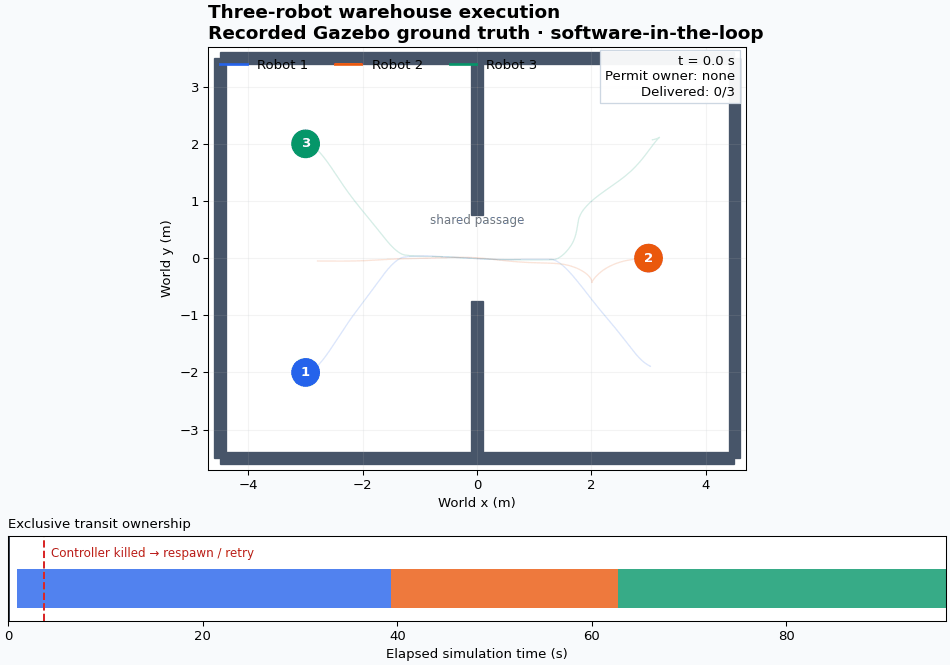

# Local Gazebo SIL qualification — 2026-09-06 PDT / 2026-09-07 UTC

**All six frozen cases passed**, with **16 completed pickup/delivery tasks**, plus a separate deliberate-contact positive control. These run actual ROS 2/Nav2 processes and Gazebo physics. They are local software-in-the-loop examples, not real hardware/HIL, cloud/production operation or a statistical reliability study.

| Case, seed 41 | Robots / completed tasks | Mission sim seconds | Episode wall seconds | Min. pair distance | Max. delivery position error |
|---|---:|---:|---:|---:|---:|
| Single robot | 1 / 1 | 29.508 | 38.125 | n/a | 0.133 m |
| Three robots, nominal | 3 / 3 | 88.803 | 98.121 | 1.080 m | 0.262 m |
| Lidar delay | 3 / 3 | 87.585 | 96.698 | 1.160 m | 0.242 m |
| Actuator hold | 3 / 3 | 89.625 | 98.433 | 1.191 m | 0.223 m |
| Controller killed / respawned | 3 / 3 | 96.408 | 106.038 | 1.166 m | 0.248 m |
| Real map-server configure reply suppressed | 3 / 3 | 80.751 | 89.970 | 1.145 m | 0.218 m |

Numbers come from the [independent summary](evidence/sil/summary.json). The six cases recorded **737,645 ROS messages** including **68,789 ground-truth position observations**. There were zero detected chassis/camera/lidar contacts and zero non-owner nonzero commands during the six missions. Minimum sampled center-to-wall distance was 0.690 m against a 0.24 m footprint bound; the maximum observed truth sample gap was 0.060 s against a 0.15 s limit. These finite sampled checks do not prove continuous collision avoidance.



The animation replays recorded world-frame positions and lease events, accelerated for review; it is not simulator camera footage. [Static frame](assets/gazebo-recovery.png), [rendering script](../scripts/render_sil.py).

## Fault observations

* Lidar delay: original source timestamps were retained; maximum observed processed-message age was 1.020 s. Cancellation was acknowledged, ownership retained and the mission retried. The settled interval contains 60 zero final-command samples, with 1.31e-06 m maximum observed drift.
* Actuator hold: the measured injection interval was 4.035 s, with 60 settled zero-command observations and 0 m drift. This is an artificial command hold, not a calibrated motor fault; simulator drift is not achievable hardware precision.
* Controller restart: the launch log records the owned process's SIGKILL exit and respawn. The oracle found 30 zero-command observations 0.5–2 simulation seconds after injection, subsequent motion and all three completed missions. Durable coordinator recovery is not implemented.
* Lifecycle response loss: a test proxy suppressed one successful configuration response from robot 3's **real map server**. Configure was forwarded exactly 1 time; the patched manager queried state and activated the stack. The bag contains 383 zero final-command samples before mission start. All three tasks completed in the same world; clean-world retry is disabled for this case. [Recovery contract and baseline](lifecycle-recovery.md).

The separate positive control intentionally drove a robot into `wall_4`, recording three camera-enclosure contacts. It is excluded from the mission zero-contact count. [Development records](evidence/sil/development-runs.json) retain unsuccessful or superseded runs separately.

## Environment and method

The [environment manifest](evidence/sil/environment.json) records host, image ID, package versions, source hashes and installed allocator/lifecycle-manager binary fingerprints. Host: Ubuntu 26.04.1, i9-13900K, 32 logical CPUs, 129,209,084 KiB RAM. Runtime: Ubuntu 24.04/Jazzy Docker, Nav2 1.3.12 with the local lifecycle-manager overlay, Gazebo Harmonic, ros_gz 1.0.22, TurtleBot simulation 1.0.1, rosbag2 MCAP 0.26.11, Python 3.12.3 and GCC 13.3.0. Fast DDS 2.14.6 / rmw_fastrtps 8.4.4 remains unchanged. Headless Ogre2/Mesa software rendering; no GPU passthrough.

Physics qualification began **2026-09-07T03:56:30.472872+00:00** and completed **2026-09-07T04:06:05.186449+00:00**, after the build and DDS preflight. Cases ran sequentially in separate Docker network/PID/Gazebo partitions with `OMP_NUM_THREADS=2`. Three Nav2 stacks run concurrently, while a conservative lease serializes full missions. This is a shared host, one seed per case, without CPU pinning or isolation from other host work. Asynchronous DDS/MPPI/physics timing prevents byte-identical results. Timings are descriptive; there is no optimization, fault-overhead distribution or field failure-rate claim.

```bash
# Linux Docker + Python 3.10+, repository root, NEW output directory.
python3 scripts/sil/qualify.py --out runs/sil/fresh-qualification
```

Normal colcon installation builds the C++ allocator and local Nav2 overlay. [Patch provenance/ABI limits](../ros2_ws/src/nav2_lifecycle_manager/LOCAL-PATCH.md) identify upstream code and local contributions. The [protocol](evidence/sil/protocol.json) freezes six cases, physical thresholds, action deadlines (180 wall seconds, at most three attempts), episode deadline (900 wall seconds), and lifecycle deadlines (1-second RPC / 15-second transition).

The source remained unchanged throughout the suite. There were **0 clean-world startup retries**. A single such retry is permitted only for other cases before mission start, with no owner and zero recorded final commands; failed attempts must be retained. Runtime failures and the lifecycle response-loss case cannot use that retry.

## Published evidence and coverage

Hash-indexed archives retain raw MCAP, generated worlds/maps/parameters, topic graphs, events, telemetry and launch logs, plus lifecycle regression/control/stress logs. [Artifact hashes](evidence/sil/artifacts.json) and [Apache notices](../third_party/NOTICE.md) accompany them.

```bash
docker build -t warehouse-fleet:jazzy-sil -f ros2/Dockerfile .
docker run --rm --network none \
  --mount "type=bind,source=$PWD,target=/work" \
  warehouse-fleet:jazzy-sil bash -lc \
  'source /opt/ros/jazzy/setup.bash && python3 /work/scripts/check_sil_evidence.py'
```

The independent checker verifies source/compressed-file hashes, rereads every raw MCAP, recomputes all six reports and checks the positive-control contact/position observations. It checks lifecycle test/control summaries against retained logs; actual test execution is performed in the qualification preflight and CI, not reconstructed by MCAP replay. [Replay receipt](evidence/sil/archive-check.json).

**65 distinct native/ROS cases passed**: 37 native cases across four CTest programs (22 core + four CLI + one discrete oracle + ten protocol/startup cases), eight allocator DDS cases, 17 lifecycle DDS cases and three readiness DDS cases. Native tests passed in [Release](evidence/sil/release-tests.log) and [ASan/UBSan/LeakSanitizer](evidence/sil/sanitizer-tests.log); [ROS build/test log](evidence/sil/adapter-tests.log). The two original-client baseline probes and 100 repeated manager-process trials are additional experiments, not additional distinct test cases. Hosted CI runs native tests, a fresh dependency-image/normal overlay build, 28 DDS cases and the original-hang control; the 100-trial campaign and six physics episodes are local evidence.

The original [360-run discrete archive](evidence/sil/discrete-archive-check.log) remains separate from the 1–3 robot physics suite. Its 10–50 robot scale and throughput comparisons do not describe this SIL adapter. The original middleware discovery trigger is not claimed fixed; the application now bounds and reconciles missing-response outcomes.
